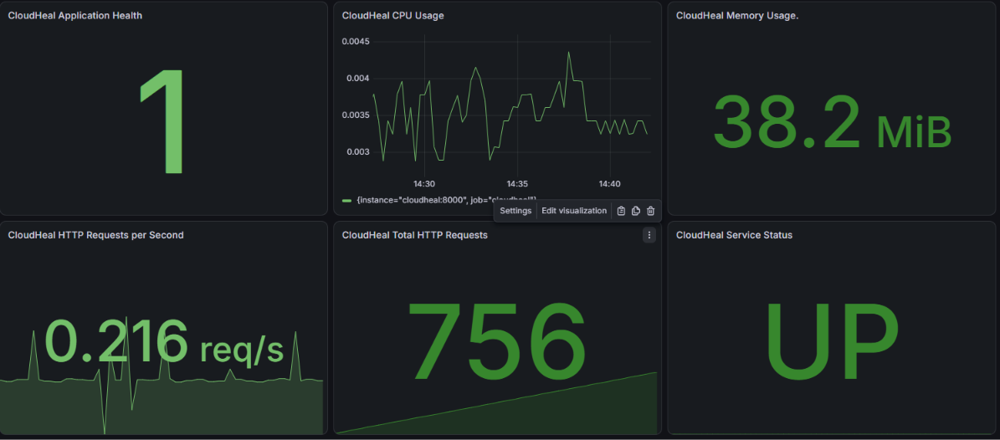

# CloudHeal – Cloud-Native DevOps Monitoring & Auto-Recovery System


CloudHeal is a cloud-native DevOps monitoring and auto-recovery learning project that demonstrates application health monitoring, metrics collection, visualization, automated testing, containerization, and Kubernetes-based recovery.

The project uses Prometheus to collect application metrics, Grafana to visualize monitoring data, and Kubernetes liveness probes to automatically restart an unhealthy application container.

## Key Features

- **Application Health Monitoring:** FastAPI health-check endpoint.
- **Metrics Collection:** Prometheus metrics and custom application health metrics.
- **Monitoring Dashboard:** Grafana dashboard for application monitoring.
- **Alerting:** Grafana alert rules for application health status.
- **Containerization:** Docker and Docker Compose.
- **Auto-Recovery:** Kubernetes liveness probes automatically restart unhealthy containers.
- **Automated Testing:** Pytest test cases.
- **CI/CD:** GitHub Actions automatically runs tests on pushes and pull requests.

## Technology Stack

| Technology | Purpose |
|---|---|
| Python | Backend programming |
| FastAPI | REST API |
| Prometheus | Metrics collection |
| Grafana | Monitoring dashboard |
| Docker | Containerization |
| Docker Compose | Multi-container management |
| Kubernetes | Deployment and auto-recovery |
| Pytest | Automated testing |
| GitHub Actions | Continuous Integration |

## Project Architecture

1. FastAPI runs the CloudHeal application.
2. Prometheus collects application metrics from `/metrics`.
3. Grafana connects to Prometheus and displays monitoring dashboards.
4. Kubernetes manages the application pod.
5. Kubernetes liveness probes monitor `/health` and restart the container after repeated failures.
6. GitHub Actions runs automated tests whenever code is pushed or a pull request is created.

## Grafana Monitoring Dashboard

The CloudHeal Grafana dashboard provides a visual overview of application health and performance.

The dashboard includes six monitoring panels:

- Application Health
- CPU Usage
- Memory Usage
- HTTP Requests Per Second
- Total HTTP Requests
- Service Status



## Project Structure

```text
CloudHeal/
│
├── .github/
│   └── workflows/
│       └── tests.yml
│
├── k8s/
│   └── deployment.yaml
│
├── prometheus/
│   └── prometheus.yml
│
├── tests/
│   └── test_main.py
│
├── main.py
├── requirements.txt
├── Dockerfile
├── docker-compose.yml
├── deployment.yaml
├── service.yaml
├── .dockerignore
├── .gitignore
├── dashboard.png
└── README.md
```

## Local Setup

### 1. Create and activate a virtual environment

```powershell
py -m venv .venv
.venv\Scripts\Activate.ps1
```

### 2. Install dependencies

```powershell
python -m pip install -r requirements.txt
```

### 3. Start the application

```powershell
uvicorn main:app --reload
```

### Application URLs

- API: http://127.0.0.1:8000
- Swagger API Documentation: http://127.0.0.1:8000/docs
- Health Check: http://127.0.0.1:8000/health
- Metrics: http://127.0.0.1:8000/metrics

## Docker Monitoring Stack

Start all services:

```powershell
docker compose up --build
```

### Access the Services

- CloudHeal API: http://localhost:8000
- Prometheus: http://localhost:9090
- Grafana: http://localhost:3000

Grafana's initial local login is `admin / admin`. Change the password after your first login.

## Kubernetes Deployment & Auto-Recovery

CloudHeal was deployed using Docker Desktop Kubernetes.

### 1. Apply the deployment and service configurations

```powershell
kubectl apply -f deployment.yaml
kubectl apply -f service.yaml
```

### 2. Check the deployment

```powershell
kubectl get pods
kubectl get deployments
kubectl get services
```

### 3. Access CloudHeal

http://localhost:30080

### Automatic Recovery Demonstration

Trigger a simulated application failure:

```powershell
Invoke-RestMethod -Method Post -Uri http://localhost:30080/demo/fail
```

Monitor the Kubernetes pod:

```powershell
kubectl get pods -w
```

Kubernetes detects repeated health-check failures through the liveness probe and automatically restarts the application container.

Verify recovery:

```powershell
Invoke-RestMethod -Uri http://localhost:30080/health
```

Expected response:

```json
{
  "status": "healthy"
}
```

**Note:** The demo failure endpoint is intended only for learning and testing. Do not expose it in production.

## Automated Testing

Run the test suite:

```powershell
python -m pytest -q
```

### Latest Local Test Result

- 3 tests passed
- 0 tests failed

## GitHub Actions – Continuous Integration

GitHub Actions is configured to run automatically on:

- Push events
- Pull requests

### Workflow Steps

1. Checks out the repository.
2. Sets up Python 3.11.
3. Installs project dependencies.
4. Runs automated tests using Pytest.

**Latest workflow execution:** Successful.

## Project Outcomes

- Implemented application health monitoring using FastAPI.
- Collected application metrics using Prometheus.
- Created Grafana monitoring dashboards and alert rules.
- Containerized the application using Docker.
- Deployed the application using Kubernetes.
- Demonstrated automatic container restart after application failure.
- Implemented automated testing using Pytest.
- Configured GitHub Actions for continuous integration.

## Repository

GitHub: https://github.com/Dharshini2812/CloudHeal

## Future Enhancements

- Configure SMTP for actual email alert delivery.
- Add Kubernetes resource monitoring.
- Implement advanced recovery strategies.
- Improve monitoring dashboards and alerting.
- Extend automated test coverage.

---

**CloudHeal – Monitoring, Detecting and Recovering from Application Failures.**